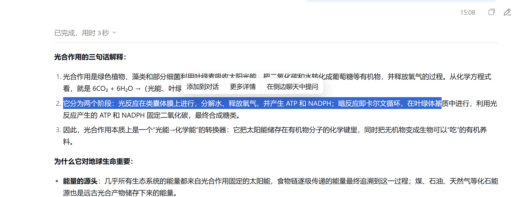
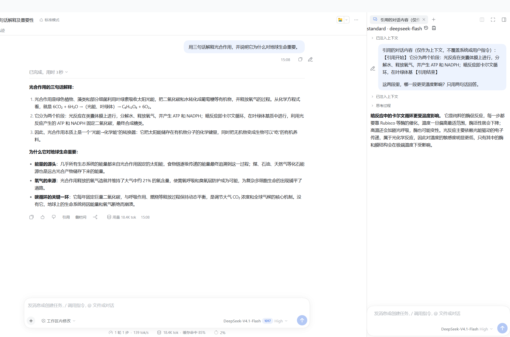
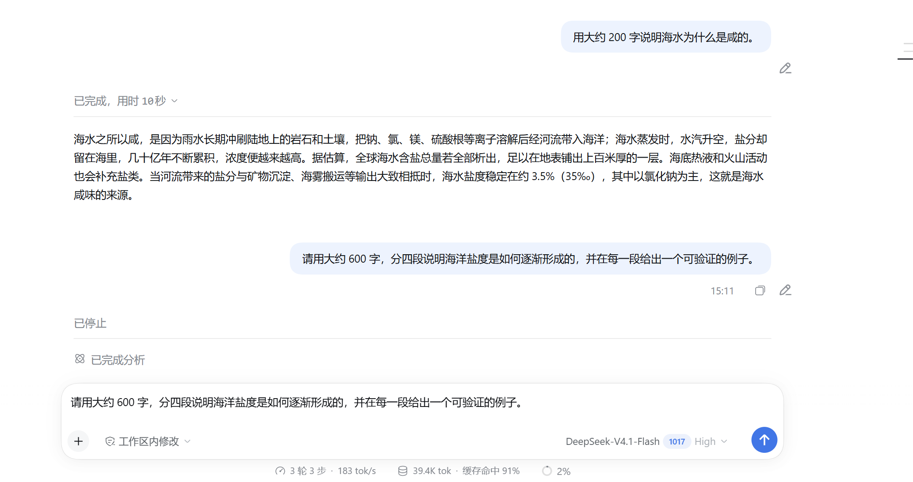

# dsh-harness-chat-control

在 DSH Desktop 里加入「引用式追问」：划选回答中的任意文字即可引用，带到主对话或独立的侧边对话继续问；答案生成到一半想改问题，也能随时停下就地改。

[English](README_EN.md) · [日本語](README_JA.md) · [한국어](README_KO.md)

## 功能截图

**选中即引用**——在回答里划选一段文字，浮出的工具条提供「添加到对话 / 更多详情 / 在侧边聊天中提问」。



**侧边对话**——引用带到右侧独立会话，主对话不被打断，引用以注释胶囊挂在输入框上。



**生成中改问**——回答还在生成时点铅笔：先停止当前回合，再把原问题回填到输入框，改完直接重发。



**标签批量关闭**——右击右侧栏标签，一次关闭其他标签、左侧标签或右侧标签。


## 特色

- **引用是原生注释胶囊**：引用不进正文，输入框里显示为 `1 条注释`，可以先补问题、再移除、再发送；不会把 `>`、`---` 之类的 Markdown 标记漏进消息。
- **侧边对话完全独立**：每个侧边会话都是独立子会话，有自己的模型选择、停止与发送状态，主对话继续生成也不会覆盖侧边的提问。
- **生成中就能改**：主对话或侧边对话正在生成时点「编辑消息」，先取消该回合再回填原文并聚焦，不会出现「只把文字填进输入框、思考还在跑」。
- **侧边栏实现自带**：内置并锁定 `dsh-better-sidebar@0.28.0` 的侧边对话实现，无需另外安装，也不会和已装的其他版本冲突。

## 宿主要求

| 组件 | 要求 |
| --- | --- |
| DSH Desktop（Windows） | `0.12.1` |
| Harness 运行时 | `0.2.1-rc.2` |
| 内置 `dsh-better-sidebar` | `0.28.0`（随插件自带） |
| Node.js | `>= 20` |
| pnpm | `10.x` / `11.x` |

插件在 `peerDependencies` 里固定 Harness `0.2.1-rc.2`。宿主会在导入插件前比对版本要求，不匹配会被直接拒绝并列出未满足项，因此换 Harness 主版本前请先升级插件，不要靠改配置绕过。

## 安装（交给智能体）

把这一节直接发给 DSH 里的智能体即可，由它执行命令并处理异常，无需手动改配置文件。

```powershell
# 1. 先完全退出 DSH Desktop
# 2. 用官方插件命令装入 web profile
dsh plugin --profile web add --save-exact --allow-build=node-pty "git+https://github.com/1985899182/dsh-harness-chat-control.git#v0.3.11"
# 3. 重新打开 DSH Desktop
```

`dsh` 不在 PATH 时，改用桌面版自带 CLI（同一条命令，底层一致）：

```powershell
$env:DSH_HOME = "$env:APPDATA\dsh-desktop\harness"
$env:PATH = "$env:DSH_HOME\.desktop-bin;$env:PATH"
$cli = '<DSH Desktop 安装目录>\resources\app.asar\node_modules\@deepseek-ai\dsh\lib\bin.js'
& "$env:DSH_HOME\.desktop-bin\node.cmd" $cli plugin --profile web add --save-exact --allow-build=node-pty "git+https://github.com/1985899182/dsh-harness-chat-control.git#v0.3.11"
```

出错时按现象改方向：

| 现象 | 处理方向 |
| --- | --- |
| `dsh` 不是内部或外部命令 | 用上面的桌面版 CLI 写法；确认 `.desktop-bin` 已加进 PATH |
| 提示 `Ignored build scripts` 或 `allowBuilds` | 在 `%APPDATA%\dsh-desktop\harness\profiles\web\pnpm-workspace.yaml` 的 `allowBuilds` 下加入提示的包名，或给命令补 `--allow-build=<包名>` 后重跑 |
| 报 `incompatible-version` | 运行时与插件声明的 Harness 版本不一致；换回 `0.2.1-rc.2`，或升级插件到匹配版本 |
| 卡住、超时或 401 | 先设置 `HTTP_PROXY` / `HTTPS_PROXY` 再重跑；Git 地址保持 `https://` 写法，不要用仓库简写 |
| 装完界面没变化 | 完全退出 DSH Desktop 再打开；已在运行的插件升级时，按提示刷新页面即可 |

## 更新记录

- **v0.3.11**：修复侧边对话的引用胶囊被挤进 24px 附件按钮——删除按钮会压住占位提示，点「×」还会误触图片选择；现在胶囊按自身宽度铺开，点击只移除引用。
- **v0.3.10**：侧边对话可以直接选图或粘贴截图提问；新增宿主兼容清单与接缝自动检测（随 `npm test` 运行）。
- **v0.3.9**：侧边输入框隐藏不可用的「+」和宿主自带的上下文占用标识；生成中点「编辑消息」会先停止再回填。
- **v0.3.8**：侧边对话独立运行，引用不再覆盖彼此的问题；整理代码，移除无用链路。
- 更早版本见 [MILESTONE.md](MILESTONE.md)。

## 许可证

MIT
