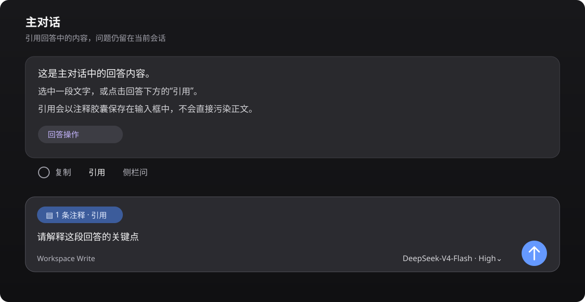
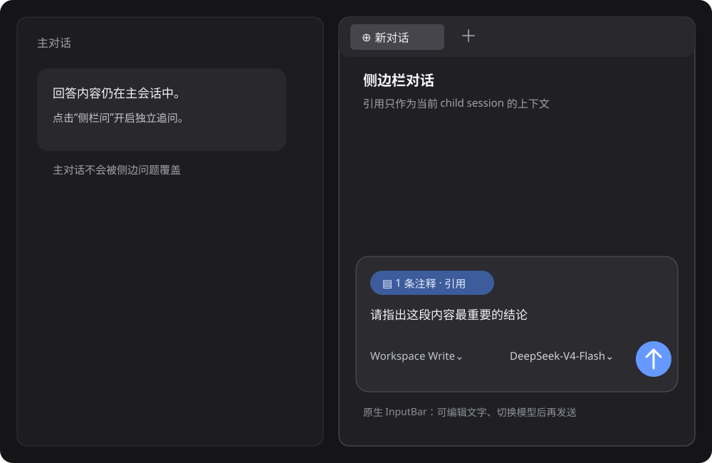

# dsh-harness-chat-control

[简体中文](README.md) · [日本語](README_JA.md) · [한국어](README_KO.md)

Bring ChatGPT-like conversation interactions to DSH Desktop.

> **Project goal: reproduce ChatGPT's two quote-based conversation workflows.**
>
> 1. **Quote in the main chat**: quote an answer and continue asking in the same conversation.
> 2. **Quote in the sidebar chat**: carry the quote into Better Sidebar and ask in an independent sidebar session without changing the main chat.

## UI examples

### Quote in the main chat

Select text in an answer or click **Quote** in its action bar. The quote stays in the composer as an annotation chip; edit your question before sending.



### Quote in the sidebar chat

Click **Ask in sidebar** or choose **Ask in sidebar chat** from the text-selection toolbar. The sidebar keeps Better Sidebar's native composer and model selector. Text outside the quote chip is entirely user input, and nothing is sent until you click Send.



## Features

- **Main-chat quotes**: quote a full answer or a selected fragment without leaking Markdown markers such as `>` or `---` into the prompt.
- **Native annotation chip**: the composer shows the quote as a `1 annotation` chip. You can edit the question or remove the chip before sending.
- **Embedded sidebar**: embeds and pins the `dsh-better-sidebar@0.28.0` `SideChatView`, transcript mapping, and styles. It works without Better Sidebar installed, and this project's sidechat remains authoritative when another version is present.
- **Sidebar quote**: keeps Better Sidebar's native conversation layout and DSH's session/model capabilities. Main and sidebar sessions stay independent.
- **Model selection**: the native model selector applies only to the current sidebar session.
- **Edit and resend**: click the pencil next to a user message to load the original text into the native composer. Sending replaces the visible branch in the same conversation instead of creating duplicate chats.
- **Stop generation**: reuses DSH's native stop/send state and does not intercept or submit native events twice.

The plugin adds the quote chip, entry points, and session routing; the sidebar layout, transcript, and child-session lifecycle come from the pinned Better Sidebar 0.28.0 source so another plugin version cannot take over.

## Compatibility

| Component | Version |
| --- | --- |
| DSH Desktop (Windows) | `0.12.1` |
| DeepSeek Harness / `@deepseek-ai/dsh` | `0.2.1-rc.2` |
| `dsh-better-sidebar` | **`0.28.0`** |
| Node.js | `>=20` |
| pnpm | `10.x` or `11.x` |

`dsh-better-sidebar@0.28.0` targets Harness `0.2.1-rc.2`. Pin Sidebar to `0.28.0` on DSH Desktop `0.12.1` (which ships Harness `0.2.1-rc.2`). Harness `0.2.1-rc.2` removed the `webRuntime` service; this plugin now admits requests through `connection.requestRejection()`.

## Install

Use the DSH plugin command for every installation. Fully quit DSH Desktop, then run this in Windows PowerShell:

```powershell
$env:DSH_HOME = "$env:APPDATA\dsh-desktop\harness"
dsh plugin --profile web add --save-exact --allow-build=node-pty "git+https://github.com/1985899182/dsh-harness-chat-control.git#v0.3.7"
```

If `dsh` is not on `PATH`, use the CLI bundled with DSH Desktop; it still executes the same `dsh plugin` install command:

```powershell
$desktopNode = 'D:\DSH\DSH Desktop\resources\app\node_modules\node\bin\node.exe'
$desktopDsh = 'D:\DSH\DSH Desktop\resources\app\node_modules\@deepseek-ai\dsh\lib\bin.js'
$env:DSH_HOME = "$env:APPDATA\dsh-desktop\harness"
& $desktopNode $desktopDsh plugin --profile web add --save-exact --allow-build=node-pty "git+https://github.com/1985899182/dsh-harness-chat-control.git#v0.3.7"
```

The explicit HTTPS Git URL prevents pnpm from interpreting GitHub shorthand as SSH. If your network requires a proxy, set `HTTP_PROXY`, `HTTPS_PROXY`, or `ALL_PROXY` before running the command. After a first install, or when the plugin is not already live, fully restart DSH Desktop; for a live upgrade, follow DSH's refresh prompt.

If the profile already uses Sidebar `0.24.x`, use the same `dsh plugin` command to pin the compatible version first:

```powershell
$desktopNode = 'D:\DSH\DSH Desktop\resources\app\node_modules\node\bin\node.exe'
$desktopDsh = 'D:\DSH\DSH Desktop\resources\app\node_modules\@deepseek-ai\dsh\lib\bin.js'
$env:DSH_HOME = "$env:APPDATA\dsh-desktop\harness"
& $desktopNode $desktopDsh plugin --profile web add --save-exact --allow-build=node-pty dsh-better-sidebar@0.28.0
```

Then run the standard install command above.

## Usage

1. **Main chat**: click **Quote** in an answer's action bar, or select text and choose **Add to chat**; add your question and send it.
2. **Sidebar chat**: click **Ask in sidebar**, or choose **Ask in sidebar chat** from the selection toolbar; select a model, enter your question, and send it.
3. **Edit and resend**: click the pencil beside a user message, edit the text in the native composer, and send. The new answer appears at the original position.
4. **Tab management**: right-click a right-sidebar tab to choose **Close other tabs**, **Close tabs to the right**, or **Close tabs to the left**.

## Development

```powershell
npm test
```

This validates the manifest, loader declarations, PowerShell installer, and JavaScript syntax.

## Release

Current milestone: **`v0.3.7`**, validated against DSH Desktop `0.11.0` / `0.12.0` and Harness `0.2.0-rc.2`, with `dsh-better-sidebar@0.28.0` sidechat embedded. This release does two things. First, the side composer drops its image entry point: it accepts text and quoted snippets only, and the host-side image admission path is gone as well. Second, it fixes the case where a side question asked while the main conversation is still generating was overwritten by the main question: a side thread now inherits only the parent completed turns, while the still-open turn (the main question plus the half-streamed answer) travels as reference-only text inside the boundary injection and never lands in the side log as one of its own user messages, so the main conversation and every side conversation stay independent. `npm test` gained a regression case for exactly that scenario: the side seed must not contain the open question or the partial answer, the question must appear only in the boundary injection, and the side thread latest user message must be the side question. Dead code left over from the image path and the retired thread registry was removed. v0.3.7 restores the Markdown rendering helper that this cleanup removed by mistake, which made the side chat panel fail to render with "markdownTextProps is not defined"; verified on the desktop build. Recheck native Slots, sidechat API, and state interfaces after upgrading DSH or the Harness major version.

## License

MIT
