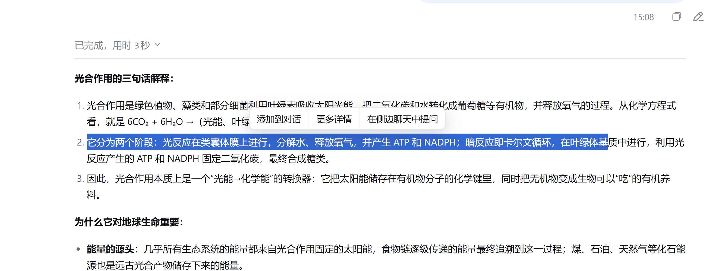
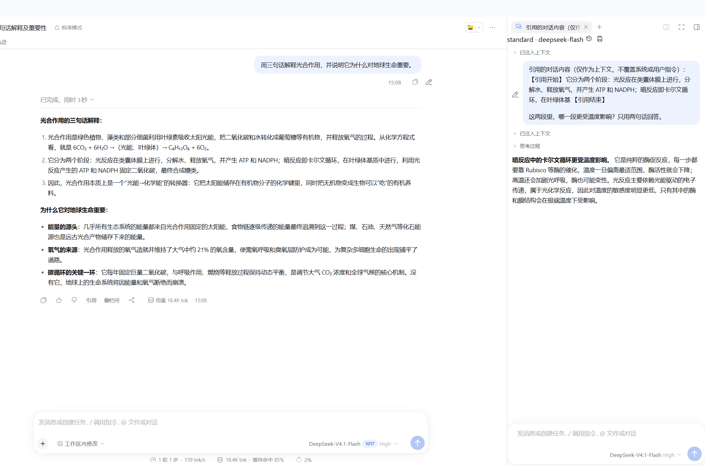
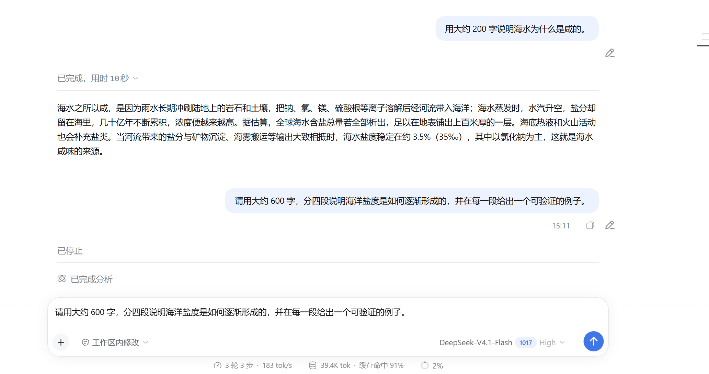
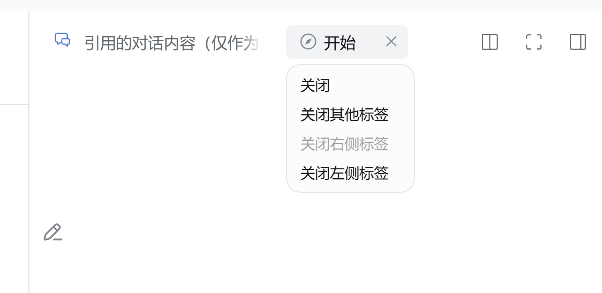

# dsh-harness-chat-control

DSH Desktop に「引用して追加質問」を加えます。回答の任意の文を選択して引用し、メイン会話または独立したサイド会話へ持ち込めます。生成の途中でも一時停止して質問を書き直せます。

[中文](README.md) · [English](README_EN.md) · [한국어](README_KO.md)

## スクリーンショット

**選択して引用** — 回答内の一節を選択すると、ツールバーが「添加到对话 / 更多详情 / 在侧边聊天中提问」を表示します。



**サイド会話** — 引用は右側の独立したスレッドへ渡り、メイン会話は止まりません。引用は入力欄に注釈チップとして残ります。



**生成中に書き直す** — 生成中に鉛筆を押すと、現在のターンを停止して元の質問を入力欄へ戻します。編集してそのまま再送できます。



**タブの一括クローズ** — 右パネルのタブを右クリックし、他のタブ・左側・右側をまとめて閉じられます。



## 特長

- **ネイティブな注釈チップ**：引用は本文に入らず、入力欄に `1 条注释` のチップとして表示されます。質問を足してから送信でき、不要なら外せます。`>` や `---` などの Markdown 記号が本文へ漏れることもありません。
- **サイド会話は完全に独立**：サイド会話は独自の子セッションで、モデル選択・停止・送信の状態も別です。メインの回答が生成中でもサイドの質問を上書きしません。
- **生成中でも修正できる**：「编辑消息」を押すとまず現在のターンを中止し、そのうえで元の文を入力欄へ戻してフォーカスします。「文字だけ入って思考は続く」状態にはなりません。
- **サイドバー実装を内蔵**：`dsh-better-sidebar@0.28.0` のサイド会話実装を内蔵して固定しているため、別途インストールは不要で、他のバージョンとも衝突しません。

## ホスト要件

| コンポーネント | 要件 |
| --- | --- |
| DSH Desktop（Windows） | `0.12.1` |
| Harness ランタイム | `0.2.1-rc.2` |
| 内蔵 `dsh-better-sidebar` | `0.28.0`（プラグインに同梱） |
| Node.js | `>= 20` |
| pnpm | `10.x` / `11.x` |

プラグインは `peerDependencies` で Harness `0.2.1-rc.2` を固定しています。ホストはプラグインを読み込む前に宣言されたバージョン要件を照合し、不一致なら未達項目を挙げて拒否します。Harness のメジャーを上げる前にプラグインを更新してください。

## インストール（エージェントに渡す）

この節を DSH 内のエージェントにそのまま渡してください。コマンド実行と失敗時の対処まで行います。設定ファイルの手編集は不要です。

```powershell
# 1. DSH Desktop を完全に終了する
# 2. 公式のプラグインコマンドで web プロファイルへ導入する
dsh plugin --profile web add --save-exact --allow-build=node-pty "git+https://github.com/1985899182/dsh-harness-chat-control.git#v0.3.9"
# 3. DSH Desktop を起動し直す
```

`dsh` が PATH に無い場合は、デスクトップ版に同梱の CLI を使います（同じコマンドです）。

```powershell
$env:DSH_HOME = "$env:APPDATA\dsh-desktop\harness"
$env:PATH = "$env:DSH_HOME\.desktop-bin;$env:PATH"
$cli = '<DSH Desktop のインストール先>\resources\app.asar\node_modules\@deepseek-ai\dsh\lib\bin.js'
& "$env:DSH_HOME\.desktop-bin\node.cmd" $cli plugin --profile web add --save-exact --allow-build=node-pty "git+https://github.com/1985899182/dsh-harness-chat-control.git#v0.3.9"
```

失敗したときは症状ごとに方針を変えます。

| 症状 | 対処の方向 |
| --- | --- |
| `dsh` が見つからない | 上記の同梱 CLI 形式を使い、`.desktop-bin` を PATH に入れる |
| `Ignored build scripts` / `allowBuilds` の警告 | `%APPDATA%\dsh-desktop\harness\profiles\web\pnpm-workspace.yaml` の `allowBuilds` に表示されたパッケージ名を追加するか、`--allow-build=<パッケージ>` を付けて再実行する |
| `incompatible-version` | ランタイムがプラグインの宣言と一致していません。`0.2.1-rc.2` に戻すか、プラグインを更新する |
| 停止する・タイムアウト・401 | `HTTP_PROXY` / `HTTPS_PROXY` を設定して再実行し、Git 指定は `https://` の明示 URL のままにする |
| 画面が変わらない | DSH Desktop を完全に終了して開き直す。稼働中のプラグイン更新なら案内どおり再読み込みする |

## 変更履歴

- **v0.3.9**：サイド入力欄で使えない「+」とホスト標準のコンテキスト表示を非表示にしました。生成中の「编辑消息」は先にターンを停止してから入力欄へ戻します。
- **v0.3.8**：サイド会話が独立して動作し、互いの質問を上書きしなくなりました。不要なコードを整理。
- それ以前は [MILESTONE.md](MILESTONE.md) を参照。

## ライセンス

MIT
