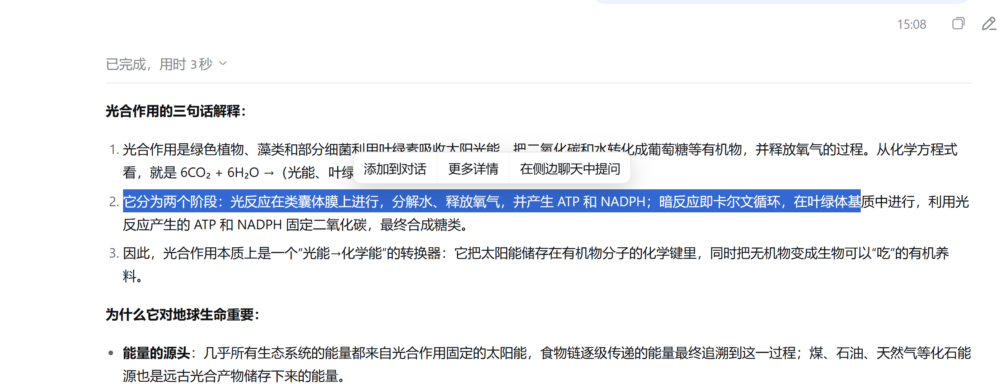
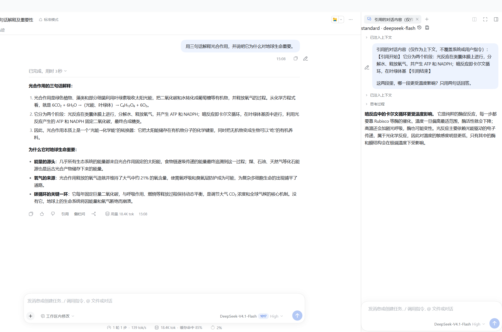
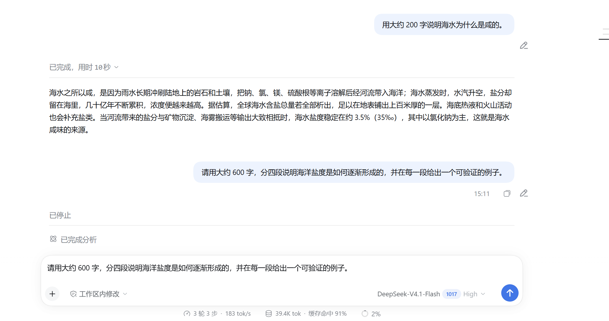
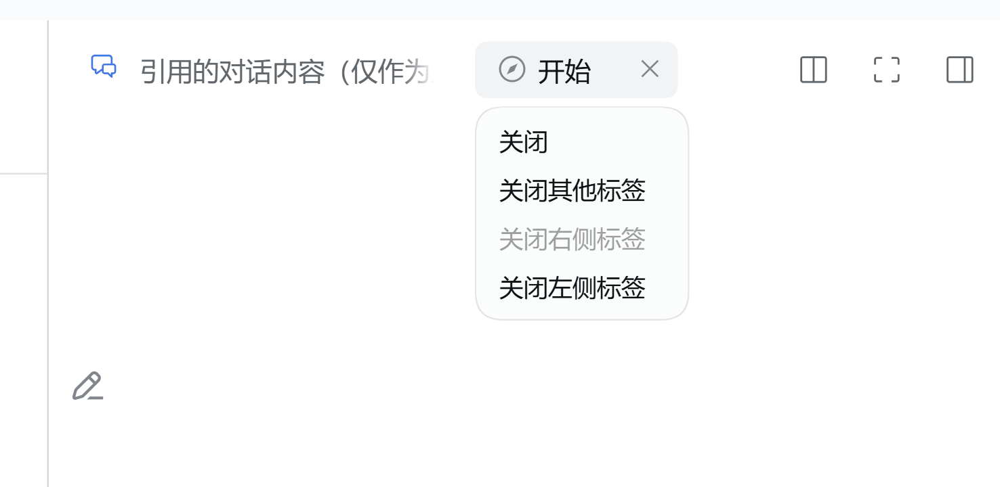

# dsh-harness-chat-control

DSH Desktop에 「인용 후 이어 묻기」를 더합니다. 답변의 아무 문장이나 선택해 인용하고, 메인 대화 또는 독립된 사이드 대화로 가져가 이어서 질문할 수 있습니다. 생성 중에도 멈추고 질문을 바로 고칠 수 있습니다.

[中文](README.md) · [English](README_EN.md) · [日本語](README_JA.md)

## 스크린샷

**선택해서 인용** — 답변에서 문장을 선택하면 「添加到对话 / 更多详情 / 在侧边聊天中提问」 도구 모음이 나타납니다.



**사이드 대화** — 인용은 오른쪽의 독립된 스레드로 전달되고 메인 대화는 계속 진행됩니다. 인용은 입력창에 주석 칩으로 남습니다.



**생성 중 수정** — 생성 중에 연필을 누르면 현재 턴을 먼저 멈추고 원래 질문을 입력창에 되돌립니다. 고친 뒤 그대로 다시 보낼 수 있습니다.



**탭 일괄 닫기** — 오른쪽 패널의 탭을 오른쪽 클릭해 다른 탭, 왼쪽 탭, 오른쪽 탭을 한 번에 닫습니다.



## 특징

- **네이티브 주석 칩**：인용은 본문에 들어가지 않고 입력창에 `1 条注释` 칩으로 표시됩니다. 질문을 덧붙인 뒤 보내거나, 필요 없으면 칩만 지울 수 있습니다. `>` 나 `---` 같은 Markdown 표시가 본문으로 새지 않습니다.
- **사이드 대화는 완전히 독립**：사이드 대화는 자체 자식 세션으로 모델 선택, 중지, 전송 상태를 따로 가집니다. 메인 답변이 생성 중이어도 사이드 질문을 덮어쓰지 않습니다.
- **생성 중에도 수정 가능**：「编辑消息」를 누르면 현재 턴을 먼저 취소한 뒤 원문을 입력창에 채우고 포커스합니다. “글자만 복사되고 사고는 계속되는” 상황이 생기지 않습니다.
- **사이드바 구현 내장**：`dsh-better-sidebar@0.28.0` 의 사이드 대화 구현을 내장해 고정하므로 따로 설치할 필요가 없고 다른 버전과 충돌하지 않습니다.

## 호스트 요구 사항

| 구성 요소 | 요구 사항 |
| --- | --- |
| DSH Desktop (Windows) | `0.12.1` |
| Harness 런타임 | `0.2.1-rc.2` |
| 내장 `dsh-better-sidebar` | `0.28.0` (플러그인에 포함) |
| Node.js | `>= 20` |
| pnpm | `10.x` / `11.x` |

플러그인은 `peerDependencies` 에서 Harness `0.2.1-rc.2` 를 고정합니다. 호스트는 플러그인을 불러오기 전에 선언된 버전 요구 사항을 비교하고, 맞지 않으면 충족되지 않은 항목을 나열하며 거부합니다. Harness 메이저를 올리기 전에 플러그인을 먼저 업데이트하세요.

## 설치 (에이전트에게 맡기기)

이 절을 DSH 안의 에이전트에게 그대로 전달하세요. 명령 실행과 실패 처리를 에이전트가 수행하며, 설정 파일을 직접 고칠 필요는 없습니다.

```powershell
# 1. DSH Desktop 을 완전히 종료
# 2. 공식 플러그인 명령으로 web 프로파일에 설치
dsh plugin --profile web add --save-exact --allow-build=node-pty "git+https://github.com/1985899182/dsh-harness-chat-control.git#v0.3.9"
# 3. DSH Desktop 다시 실행
```

`dsh` 가 PATH 에 없으면 데스크톱 앱에 포함된 CLI 를 사용하세요(내부적으로 같은 명령입니다).

```powershell
$env:DSH_HOME = "$env:APPDATA\dsh-desktop\harness"
$env:PATH = "$env:DSH_HOME\.desktop-bin;$env:PATH"
$cli = '<DSH Desktop 설치 경로>\resources\app.asar\node_modules\@deepseek-ai\dsh\lib\bin.js'
& "$env:DSH_HOME\.desktop-bin\node.cmd" $cli plugin --profile web add --save-exact --allow-build=node-pty "git+https://github.com/1985899182/dsh-harness-chat-control.git#v0.3.9"
```

실패하면 증상별로 방향을 바꾸세요.

| 증상 | 대응 |
| --- | --- |
| `dsh` 를 찾을 수 없음 | 위의 내장 CLI 형식을 쓰고 `.desktop-bin` 을 PATH 에 넣기 |
| `Ignored build scripts` / `allowBuilds` 경고 | `%APPDATA%\dsh-desktop\harness\profiles\web\pnpm-workspace.yaml` 의 `allowBuilds` 에 안내된 패키지 이름을 추가하거나 `--allow-build=<패키지>` 를 붙여 다시 실행 |
| `incompatible-version` | 런타임이 플러그인이 선언한 Harness 버전과 다름. `0.2.1-rc.2` 로 되돌리거나 플러그인을 업그레이드 |
| 멈춤, 시간 초과, 401 | `HTTP_PROXY` / `HTTPS_PROXY` 를 설정하고 재실행. Git 주소는 `https://` 명시 URL 유지 |
| 화면이 그대로 | DSH Desktop 을 완전히 종료했다가 다시 열기. 실행 중 플러그인 업그레이드는 안내대로 새로고침 |

## 변경 기록

- **v0.3.9**：사이드 입력창에서 쓸 수 없는 「+」 와 호스트 기본 컨텍스트 표시를 숨겼습니다. 생성 중 「编辑消息」는 턴을 먼저 멈춘 뒤 입력창을 채웁니다.
- **v0.3.8**：사이드 대화가 독립적으로 동작해 서로의 질문을 덮어쓰지 않습니다. 불필요한 코드 정리.
- 이전 버전은 [MILESTONE.md](MILESTONE.md) 참고.

## 라이선스

MIT
